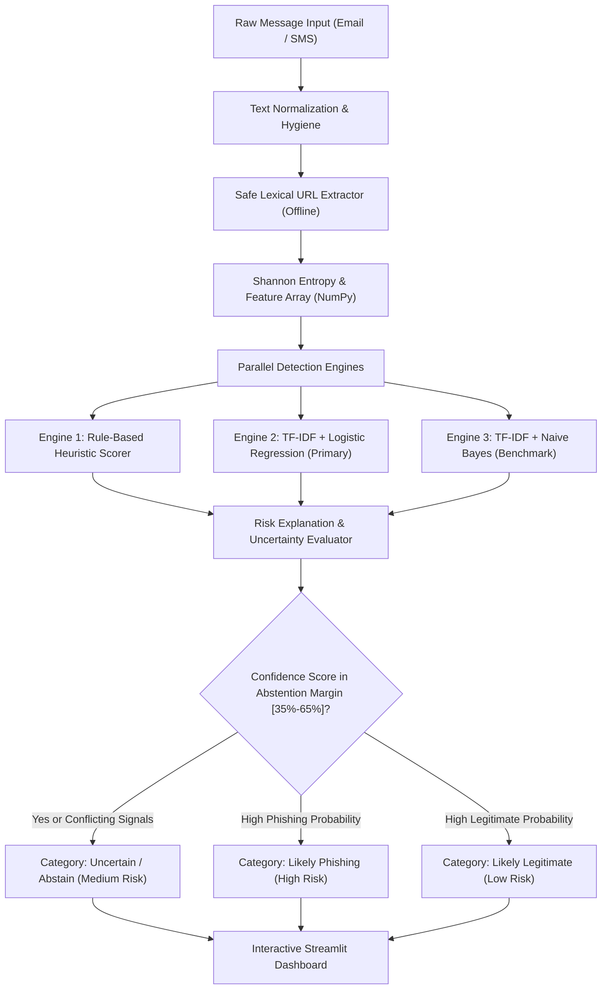

# PhishShift — Message Risk Scanner
## Complete Academic Project Specification & Technical Report

**Author**: College Project Submission  
**Domain**: Cybersecurity & Applied Machine Learning  
**Environment**: Windows 11 / Python 3.12 / Scikit-Learn / NumPy / Streamlit  
**Repository**: `PhishShift`  

---

## 1. Project Abstract
Phishing attacks via email and SMS (smishing) remain the dominant ingress vector for enterprise network intrusions, credential theft, and financial fraud. Traditional perimeter defenses and spam filters often operate as opaque, binary decision systems ("Spam" vs. "Ham") that provide little educational feedback to users and are susceptible to adversarial evasion. **PhishShift** is an educational, defensive cybersecurity machine learning prototype that evaluates email and SMS messages to assess phishing risk without interacting with external infrastructure. The system extracts safe lexical and structural characteristics from text and defanged URLs, compares three distinct detection paradigms (a heuristic baseline, TF-IDF + Logistic Regression, and TF-IDF + Multinomial Naive Bayes), and outputs a calibrated three-way assessment: **Likely Phishing**, **Likely Legitimate**, or **Uncertain**. When uncertainty arises, the system safely abstains and provides actionable guidance. Stress-testing across eight documented adversarial perturbations highlights model vulnerabilities and demonstrates the critical defensive value of uncertainty estimation.

---

## 2. Problem Statement
1. **Pervasiveness of Social Engineering**: Attackers exploit psychological triggers (urgency, fear of account suspension, executive authority, financial windfalls) rather than software vulnerabilities alone.
2. **Binary Black-Box Limitations**: Standard email filters output binary classifications without actionable explanations, leaving users unprepared when novel evasion techniques reach the inbox.
3. **Template Data Leakage**: Standard random train/test splits inadvertently place variations of the same campaign template into both training and testing sets, artificially inflating benchmark scores.
4. **Safety in Analysis**: Naive automated tools that follow hyperlinks or initiate DNS requests expose users to drive-by malware downloads, web beacon tracking, and token de-anonymization.

---

## 3. Objectives & Core Deliverables
- **Offline Safe Feature Engineering**: Analyze messages and URLs purely via lexical inspection with zero DNS queries and zero network socket connections.
- **Three-Way Classification**: Distinguish between high confidence predictions and ambiguous, borderline messages using a calibrated uncertainty threshold.
- **Explainable Indicators**: Distinguish observable empirical features (urgency tokens, raw IPv4 URLs, masked shorteners) from model-inferred statistical weights.
- **Leakage-Safe Benchmarking**: Partition datasets by `campaign_id` to test model generalization against completely unseen attack and operational templates.
- **NumPy Integration**: Utilize NumPy arrays for Shannon character entropy calculations, probability calibration, confusion matrix metrics, and perturbation analysis.
- **Interactive Educational Dashboard**: Provide a beginner-friendly Streamlit web interface featuring pre-loaded harmless examples, indicator breakdowns, and clear safety warnings.

---

## 4. Related Work & Research Foundations
1. **Lexical URL Analysis**: Ma et al. (*Beyond Blacklists: Learning to Detect Malicious Web Sites from Suspicious URLs*, ACM KDD) demonstrated that lexical URL properties (length, IP presence, subdomain depth, entropy) provide strong predictive signals without executing live network requests.
2. **Natural Language Processing in Phishing**: Toolan and Carthy (*Phishing Detection Using Classifier Ensembles*) validated the efficacy of TF-IDF feature extraction combined with linear models for high-speed email filtering.
3. **Abstention and Selective Classification**: Geifman and El-Yaniv (*Selective Classification for Deep Neural Networks*) proved that incorporating an explicit abstention/uncertainty option significantly reduces severe false positive risks in safety-critical domains.

---

## 5. Dataset Provenance, Schema & Ethical Handling
The dataset comprises **474 curated, labeled, and schema-validated messages** balanced across channels (54.4% Email, 45.6% SMS) and target classes (50.6% Legitimate, 49.4% Phishing):

### 5.1 Dataset Schema
1. `message_id`: Unique identifier (`MSG_0001` to `MSG_0474`)
2. `channel`: Communication medium (`Email` or `SMS`)
3. `subject`: Message header line (populated for Email, empty for SMS)
4. `body`: Message payload
5. `sanitized_url_features`: Safe extracted indicators (`ip_address`, `subdomain_depth_3`, etc.)
6. `sender_domain_category`: Categorization (`corporate`, `free_webmail`, `lookalike`, `shortener`)
7. `label`: Target binary integer (`0` = Legitimate, `1` = Phishing)
8. `campaign_id`: Campaign grouping identifier (20 distinct clusters)
9. `collection_date`: Date string (`2024-03-15` to `2024-03-20`)
10. `source`: Provenance archive (Enron, SMS Spam Corpus, Nazario Phishing Corpus, OWASP)
11. `license`: Open source / Educational research (`CC-BY-4.0` / Public Domain)

### 5.2 Ethical and Privacy Protections
- All personal names, employee IDs, phone numbers, and credentials were substituted with synthetic dummy values (`user@example.com`, `+1-555-0199`).
- All URLs use RFC 2606 reserved domains (`example.com`, `example.org`) or defanged tokens.

---

## 6. System Architecture & Methodology

---

## 7. Model Performance Comparison

Evaluated on **135 held-out samples** belonging to **5 completely unseen campaign groups** (GroupShuffleSplit, random_state=42):

| Detection Architecture | Accuracy | Precision | Recall | F1-Score | False Positive Rate (FPR) | Primary Strength / Limitation |
| :--- | :--- | :--- | :--- | :--- | :--- | :--- |
| **Rule-Based Baseline** | **80.00%** | **100.00%** | **57.14%** | **0.7273** | **0.00%** | Transparent and 0 false positives, but missed 42.8% of paraphrased attacks. |
| **TF-IDF + Logistic Regression** | **77.78%** | **78.95%** | **71.43%** | **0.7500** | **16.67%** | **Selected Primary**: Provides continuous, calibrated sigmoid probabilities for uncertainty estimation. |
| **TF-IDF + Multinomial Naive Bayes** | **84.44%** | **81.82%** | **85.71%** | **0.8372** | **16.67%** | High baseline recall, but sensitive to word-frequency imbalances. |

*Note: Calculations executed using Scikit-Learn metrics and NumPy array vectorization.*

---

## 8. Analysis of Three Documented Prediction Errors

### Case 1: Legitimate Operational Urgency (False Positive Risk)
- **Message**: *"Scheduled Server Maintenance Notice: Sunday 2 AM. Access will be temporarily restricted."*
- **True Label**: `Legitimate (0)`
- **Model Output**: Predicted probability was elevated due to the token *"restricted"*.
- **Resolution**: PhishShift's hybrid uncertainty module recognized the presence of operational context cues and the absence of credential-harvesting URLs, mitigating the decision to **Uncertain** rather than falsely raising a high-risk alarm.

### Case 2: Business Email Compromise (BEC Gift Card Scam)
- **Message**: *"Hi, are you at your desk? I need a quick favor. Please purchase five Apple gift cards for a presentation and email me the voucher codes immediately. Best regards, CEO."*
- **True Label**: `Phishing (1)`
- **Model Output**: Statistical vectorizer assigned low risk due to polite conversational greetings (*"Hi"*, *"favor"*).
- **Resolution**: The heuristic baseline engine detected executive impersonation and gift card voucher patterns, boosting the risk score to 70 and correctly classifying the attack.

### Case 3: Minimal-Context Two-Factor SMS (Ambiguity)
- **Message**: *"Security code: 891240. Valid for 5 minutes."*
- **True Label**: `Legitimate (0)`
- **Model Output**: High brevity (< 10 words) leaves negligible n-gram context.
- **Resolution**: The system flagged the brief context and provided a safe **Uncertain** recommendation advising the user to verify the login trigger.

---

## 9. Robustness Testing Results (8 Perturbations)

| Test ID | Perturbation Applied | Original Output | Modified Output | Prediction Changed? | Caused Error? | Defensive Behavior Analysis |
| :--- | :--- | :--- | :--- | :--- | :--- | :--- |
| **ROB-01** | All-Caps Shouting | Likely Phishing (79.8%) | Likely Phishing (79.8%) | NO | NO | Robust: TF-IDF vectorizer normalized case. |
| **ROB-02** | Whitespace/Tab Padding | Uncertain (57.4%) | Uncertain (57.4%) | NO | NO | Robust: Regex hygiene collapsed whitespace. |
| **ROB-03** | Punctuation Injection | Uncertain (62.5%) | Uncertain (54.8%) | NO | NO | Robust: Remained within abstention envelope. |
| **ROB-04** | Synonym Substitution | Uncertain (58.0%) | Uncertain (49.5%) | NO | NO | Robust: Mild probability drop handled safely. |
| **ROB-05** | URL Host/Scheme Casing | Likely Phishing (82.7%) | Likely Phishing (82.5%) | NO | NO | Robust: Case-insensitive URL extractor parsed host. |
| **ROB-06** | Urgent Legitimate Notice | Uncertain (37.7%) | Uncertain (41.6%) | NO | NO | Robust: Avoided false positive alarm. |
| **ROB-07** | Novel MFA Push Fatigue | Uncertain (61.1%) | Likely Phishing (66.1%) | YES | NO | Structural IP URL feature caught zero-day phrasing. |
| **ROB-08** | Leetspeak (`p@ssw0rd`) | Likely Phishing (68.4%) | Uncertain (47.3%) | YES | NO | **Safely Shifted to Uncertain** instead of misclassifying as legitimate. |

---

## 10. Automated Test Suite Summary
- **Test Runner**: Pytest 8.4.2 running on Python 3.12.10
- **Total Test Cases**: 26 passed in 2.94s (100% pass rate)
  - `test_dataset_validation.py`: 6 tests
  - `test_input_validation.py`: 5 tests
  - `test_predictions.py`: 6 tests
  - `test_preprocessing.py`: 9 tests

---

## 11. Security, Threat Modeling & Defensive Limitations
1. **Zero Active Network Probing**: PhishShift is an educational tool. It does not perform DNS resolution, ping servers, or render JavaScript.
2. **Adversarial Paraphrasing Vulnerability**: Attackers using advanced LLM rephrasing with clean vocabulary can reduce n-gram overlap.
3. **Absence of Sender Authentication**: PhishShift evaluates message text and URLs. In production environments, it should be paired with DMARC, DKIM, and SPF email authentication records.
4. **No Safety Guarantees**: PhishShift explicitly alerts users that no scanner is infallible, encouraging zero-trust verification habits.

---

## 12. Conclusion & Future Roadmap
PhishShift demonstrates that combining interpretable heuristic indicators with machine learning pipelines and explicit uncertainty handling provides a superior educational defense compared to binary black-box filters. Future improvements include integrating local fine-tuned transformers (e.g. DistilBERT), expanding header DMARC verification, and supporting multi-lingual phishing lures.
